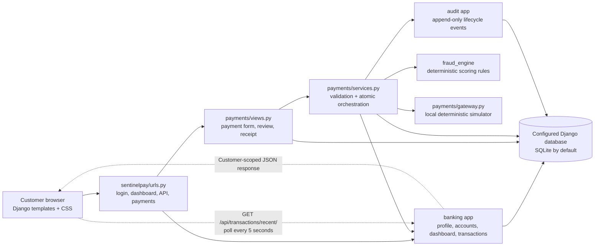
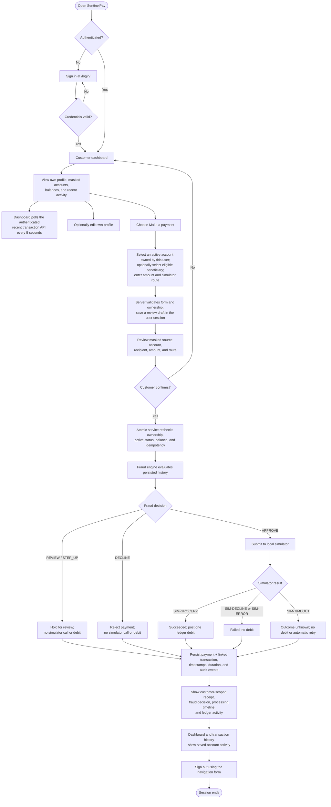

# SentinelPay: Project Walkthrough and Demo Guide

## 1. Project in one minute

SentinelPay is a Django-based educational banking and payment-fraud demonstration. A customer signs in, views their own synthetic INR account, reviews and confirms a simulated payment, and sees the resulting status, fraud decision, audit timeline, and account activity. A deterministic fraud rules engine evaluates requests before a local payment simulator returns success, decline, timeout, or error.

**Important:** this is not a real bank. It does not connect to a financial institution, move real funds, verify identity, or contact an external payment gateway. All demo accounts, balances, beneficiaries, and payment outcomes are synthetic.

## 2. System architecture diagram



### Main code responsibilities

| Component | Responsibility |
| --- | --- |
| `sentinelpay/urls.py` | Routes browser requests to authentication, banking, transaction API, and payment views. |
| `banking/` | Customer profile, owned accounts, beneficiaries, transaction records, dashboard, and customer-scoped recent-transaction API. |
| `payments/` | Payment forms, two-step review, authorization checks, state transitions, ledger posting, receipts, and fraud-review pages. |
| `payments/services.py` | Coordinates validation, fraud evaluation, simulator call, payment/transaction status, balance changes, and audit events in the existing database transaction. |
| `fraud_engine/` | Applies deterministic, explainable rules. Scores are demonstration rule points, not probabilities. |
| `payments/gateway.py` | Returns a predictable local result for the selected `SIM-*` route; it makes no external network call. |
| `audit/` | Stores append-only lifecycle and review events without passwords, authentication tokens, or full account numbers. |
| Django ORM database | Persists users, profiles, accounts, payments, transactions, ledger entries, fraud cases, and audit records. SQLite is the default unless MySQL is explicitly configured. |

## 3. Complete user and payment flow



### What happens during processing

1. The payment form offers only active source accounts belonging to the signed-in customer. Beneficiaries must be active and either customer-owned or project-wide.
2. The first submit saves a draft in the session; it does not debit an account. The customer reviews and confirms on the next page.
3. On confirmation, the payment service rechecks account ownership, active status, beneficiary eligibility, balance, and idempotency inside its database transaction.
4. Fraud evaluation is persisted with the payment. A review/step-up or decline decision stops before the simulator and never debits the account.
5. Approved payments go to the deterministic local simulator. Only simulator success plus a successful balance update creates a ledger debit.
6. A linked transaction record stores its creation time, final status, completion time, and measured processing duration. Append-only audit events record transaction creation, status changes, fraud decisions, and completion.
7. The receipt and dashboard read saved backend records. Dashboard refresh uses polling; it is not a WebSocket or push notification system.

## 4. Demo preparation

### Start the existing project

Open PowerShell in the `sentinelpay` directory (the directory containing `manage.py`):

```powershell
.\.venv\Scripts\Activate.ps1
python manage.py check
python manage.py migrate
python manage.py runserver
```

Open <http://127.0.0.1:8000/>. Keep the server terminal open.

For a fresh local database, install the declared requirements first and configure `DJANGO_SECRET_KEY` and `DEMO_PASSWORD` using local environment variables or the ignored `.env` file. `DEMO_PASSWORD` must be at least 12 characters for `seed_demo`:

```powershell
pip install -r requirements.txt
$env:DEMO_PASSWORD = "set-a-private-password-of-12-or-more-characters"
python manage.py migrate
python manage.py seed_demo
```

The seed command creates `demo.customer1` and `demo.customer2` with synthetic active INR savings accounts and one shared sample beneficiary. It does not reset existing users, passwords, or balances. The password is supplied locally; do not put it in this document, source control, or a presentation recording.

**Reliable presentation option:** register a fresh synthetic customer at `/register/` before the presentation. Registration creates an account owned by that customer, so the source-account selector is populated immediately. If reusing a seeded account, sign in as the seeded customer with the password configured when the user was first created. A Django administrator account does not automatically own a payment account.

### Pre-demo checklist

- Confirm the database shown by `python manage.py shell -c "from django.db import connection; print(connection.vendor, connection.settings_dict['NAME'])"` is the intended local database.
- Sign in as a customer with an active account; check the masked account and available INR balance on the dashboard.
- Open **Make a payment** and confirm the source-account dropdown contains that customer's active account.
- Confirm the server starts without errors and the dashboard transaction table loads.
- Use a small amount, such as `500.00 INR`, for the successful payment walkthrough. Do not use real credentials, real account details, Aadhaar, or PAN in the demo.
- Seed or register accounts only in an intentionally selected development database. Never run demo seeding against a database containing important banking data.

## 5. Suggested 7-minute presentation

### 0:00–0:45 — Introduce the project

Say: “SentinelPay demonstrates a customer banking journey and a payment fraud-screening workflow. Payments and balances are synthetic; the gateway is a local simulator and no real money moves.”

Point to the architecture diagram. Explain that Django handles pages and persistence, the payment service coordinates the flow, fraud evaluation is separate, and audit events record the outcome.

### 0:45–1:45 — Sign in and show the dashboard

1. Open `/login/` and sign in as the prepared demo customer.
2. Show customer details, masked account, available/ledger balance, monthly activity, and recent transactions.
3. Point out that account records are customer-scoped: signing in as an admin or a different customer does not expose this customer’s source account.
4. Explain that recent activity refreshes by polling the authenticated API every five seconds.

### 1:45–2:30 — Show profile and navigation

1. Open **Customer profile** and show customer-supplied profile fields and clearly labelled KYC/risk placeholders.
2. Do not enter real personal identifiers for the presentation.
3. Return to the dashboard.

### 2:30–4:30 — Complete a successful payment

1. Select **Make a payment**.
2. Choose the active source account shown in the selector.
3. Optionally select the sample beneficiary; enter `500.00`.
4. Select `SIM-GROCERY` and submit to the review page.
5. Point out that review displays a masked account and that no debit has occurred yet.
6. Confirm the payment.
7. On the receipt, show the persisted status, payment/transaction references, fraud score and decision, processing timeline, and ledger debit.
8. Return to the dashboard and show the new transaction in the live activity table.

### 4:30–5:30 — Explain alternate outcomes

Use the simulator route selector to explain the deterministic outcomes. Run one only if time permits:

| Route | Expected result | Balance impact |
| --- | --- | --- |
| `SIM-GROCERY` | Success | One debit after a successful balance update |
| `SIM-DECLINE` | Failed | No debit |
| `SIM-ERROR` | Failed | No debit |
| `SIM-TIMEOUT` | Unknown gateway outcome | No debit and no automatic retry |

Fraud rules run before the simulator. An amount of at least `100000.00` triggers 30 rule points and a `STEP_UP` decision; because step-up is not implemented, the payment is held for review without calling the simulator or debiting funds. Other rules can add points and raise the decision to review or decline. Use only a test customer/account for these experiments.

### 5:30–6:15 — Show monitoring and traceability

1. Point to the transaction status, timestamp, processing duration, and fraud outcome in the dashboard.
2. Open the transaction history page for customer-scoped activity.
3. Open the receipt timeline to show recorded backend audit events and, for a successful payment, the ledger posting.
4. Explain that audit rows are append-only and do not contain passwords or authentication tokens.

### 6:15–7:00 — Sign out and summarize

1. Sign out using the navigation button.
2. If useful, show that a protected route redirects an unauthenticated visitor to sign in.
3. Summarize: “The demo shows a complete authenticated payment lifecycle with validation, fraud screening, deterministic outcomes, audited transaction timing, and a customer-scoped live dashboard.”

## 6. Fraud and system behavior to explain accurately

- The fraud engine is deterministic and explainable. Scores are rule points capped at 100, **not** calibrated fraud probabilities.
- Current thresholds: `0–29` approve, `30–49` step-up, `50–79` review, and `80–100` decline. Since no step-up challenge is implemented, step-up decisions are held without a debit.
- Device and IP-country rules are inactive because the application does not collect those signals.
- Simulator routes are local test outcomes and are not calls to a payment provider.
- A timeout is recorded as `UNKNOWN`; it is not treated as success, does not debit funds, and is not retried automatically.
- Historical imported transaction durations cannot be reconstructed, so their processing duration may be blank.
- Live dashboard updates use configurable polling (5-second default), not server-push streaming.
- The database is determined by Django settings. SQLite is the default; do not claim the demo uses MySQL unless the runtime configuration has been checked.

## 7. Questions you may be asked

**Does this transfer real money?**  
No. Payments use a deterministic local simulator and balances are synthetic.

**Why can’t an administrator choose a source account?**  
Source accounts are filtered by owner. An administrator needs an account linked to that same user, or should sign in as a demo customer.

**Why do you ask the customer to review before submitting?**  
The two-step flow lets the customer verify the source, recipient, amount, and route before server-side checks and processing.

**How do you prevent a duplicate payment?**  
The service uses a customer-scoped idempotency key and request fingerprint, with a database uniqueness constraint.

**When is the balance changed?**  
Only after the simulator reports success and the guarded balance update succeeds. Failed, held, rejected, and unknown outcomes do not post a debit.

**How is processing time measured?**  
The service uses a monotonic timer for elapsed milliseconds and timezone-aware timestamps for creation/completion times.

**How are transactions updated live?**  
The dashboard calls the authenticated, customer-scoped recent-transaction endpoint every five seconds by default and keeps the last displayed rows if a refresh fails.

**Is this production-ready banking software?**  
No. Identity verification, real payment rails, production fraud controls, reconciliation, and production operational safeguards are outside this educational demonstration.

## 8. Closing notes

This guide describes the existing project rather than a separate replacement implementation. Before a live presentation, confirm the current branch, active database, migration state, test account password, and seeded account balance in the specific checkout being demonstrated.
